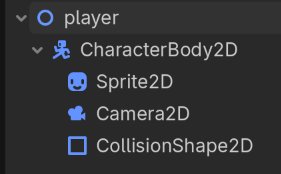

# 部件名稱

## 架構

### 節點架構

目前 `player.tscn` 下的架構如圖：



每個部件的功能如下：

| 節點 | 意義 |
| --- | --- |
| `player` | 根節點 |
| `CharacterBody2D` | 玩家本體 |
| `Sprite2D` | 玩家造型 |
| `Camera2D` | 跟隨玩家的視角 |
| `CollisionShape2D` | 玩家碰撞箱 |

### 資料流

<!-- 用 mermaid 描述資料如何移動 -->

### 部件依賴

<!-- 紀錄此部件需要依賴哪些部件 -->

## 機制

### 一般移動

#### 目的

利用 `W`, `A`, `S`, `D` 與方向鍵控制玩家移動。

#### 行為

- 按下對應按鍵時，玩家固定在視角中間，而地圖則朝反方向移動。請見[遊戲規則](../遊戲規則.md)。
- 按下按鍵時，玩家逐漸加速至預期的終端速度；鬆開按鍵時，則逐漸減速至預期速度。

#### 實做

為模擬水中阻力，使用線性的阻力將按下按鍵時的加速度寫成：

$$
\frac{d\vec{v}}{dt} = \vec{a} - k\vec{v}
$$

其中 $\frac{d\vec{v}}{dt}$ 為玩家的加速度；$\vec{a}$ 為按下按鍵時給與的速度；$k$ 為模擬的水中阻力，$\vec{v}$ 則是現在的速度。

因此，解出微分方程後，$\vec{v}(t)$ 可以寫成：

$$
\vec{v}(t) = \frac{\vec{a}}{k} + \left(\vec{v}_0 - \frac{\vec{a}}{k}\right)e^{-kt}
$$

其中 $\vec{v}_0$ 為初速。當 $t \to \infty$ 時，$\vec{v}(t) \to \dfrac{\vec{a}}{k}$（終端速度）。

#### 證明

可以使用積分因子法：對於 $y'(x) + a(x)y(x) = b(x)$，令積分因子為：

$$
\mu(x) = e^{\int a(x)\ dx}
$$

則 $y(x)$ 可以表示成：

$$
y(x) = \frac{1}{\mu(x)} \int \mu(x) b(x)\ dx + C
$$

以 $y = \vec{v}$、$a(t) = k$、$b(t) = \vec{a}$ 帶入，先求積分因子 $\mu(t)$：

$$
\mu(t) = e^{\int k\ dt} = e^{kt}
$$

將 $\mu(t)$ 代入通解公式：

$$
\begin{aligned}
\vec{v}(t) &= \frac{1}{e^{kt}} \int e^{kt} \cdot \vec{a}\ dt + C \\
&= e^{-kt} \cdot \frac{\vec{a}}{k} e^{kt} + C \\
&= \frac{\vec{a}}{k} + C
\end{aligned}
$$

若令初速 $\vec{v}_0 = \vec{v}(0)$，則可以解出 $C$：

$$
\begin{aligned}
\vec{v}_0 &= \frac{\vec{a}}{k} + C \\
C &= \vec{v}_0 - \frac{\vec{a}}{k}
\end{aligned}
$$

帶回可得：

$$
\vec{v}(t) = \frac{\vec{a}}{k} + \left(\vec{v}_0 - \frac{\vec{a}}{k}\right)e^{-kt}
$$

#### 程式碼

在 `player.md` 中：

```gdscript
func update_movement(direction: Vector2, delta: float) -> void:
    var target_velocity := direction * acceleration / water_drag

    velocity = target_velocity + (velocity - target_velocity) * exp(-water_drag * delta)
```

| 變數 | 意義 |
| --- | --- |
| `direction * acceleration` | $\vec{a}$ |
| `water_drag` | $k$ |
| `target_velocity` | $\frac{\vec{a}}{k}$ |
| `velocity` | $\vec{v}(t), \vec{v}_0$ |
| `delta` | $t$ |

由於此函式會計算出下一時刻的速度，所以 `velocity` 同時是 $\vec{v}(t)$ 與 $\vec{v}_0$。

#### 參數

可以調整的參數如下：

| 參數 | 意義 |
| --- | --- |
| `direction` | 移動方向，由`移動按鍵`決定 |
| `acceleration` | 加速度 |
| `water_drag` | 水中模擬阻力 |

#### 限制

### 設計決策

<!-- 紀錄重要設計的選擇與原因 -->

### 測試

<!-- 紀錄目前應完成的測試 -->

### 未來開發

<!-- 紀錄未來可以開發的方向 -->
