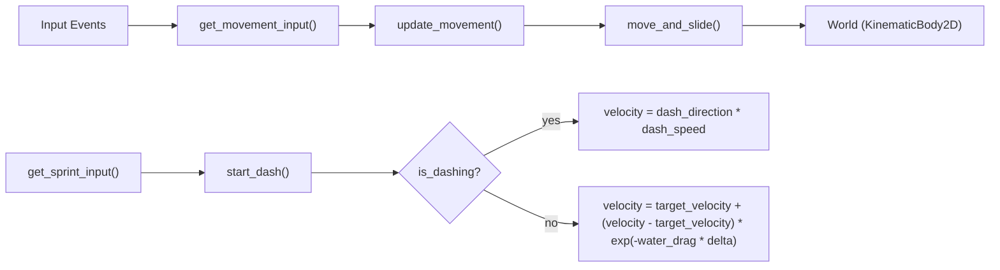

# player

## 架構

### 節點架構

目前 `player.tscn` 下的架構如圖：


每個部件的功能如下：

| 節點 | 意義 |
| --- | --- |
| `player` | 根節點 |
| `CharacterBody2D` | 玩家本體 |
| `Sprite2D` | 玩家造型 |
| `Camera2D` | 跟隨玩家的視角 |
| `CollisionShape2D` | 玩家碰撞箱 |

### 資料流



- `get_movement_input()` 每幀讀取當前按鍵狀態，輸出 `[−1, 1]` 範圍的 `Vector2`
- `update_movement()` 根據是否衝刺計算速度：
  - 衝刺中：直接設定為 `dash_direction * dash_speed`
  - 非衝刺：使用水中阻力模型計算速度
- `move_and_slide()` 將速度應用到物理世界

### 部件依賴

| 依賴 | 說明 |
| --- | --- |
| `Input.get_vector()` | Godot 內建輸入系統，讀取 UI 輸入動作並轉為方向向量 |
| `Input.is_action_just_pressed()` | 檢測單次按鍵按下事件（用於 dash） |
| `CharacterBody2D` | 提供 `velocity`、`move_and_slide()` 等移動相關 API |

## 機制

### 機制 1：水中移動

#### 目的

利用 `W`, `A`, `S`, `D` 與方向鍵控制玩家在水中的移動，並模擬水的阻力感。

#### 行為

- 按下按鍵時，玩家逐漸加速至預期終端速度；鬆開按鍵時，則逐漸減速至零。
- 移動手感模擬水中阻力，具有平滑的加減速過渡。

#### 實做

為模擬水中阻力，使用線性的阻力將按下按鍵時的加速度寫成：

$$
\frac{d\vec{v}}{dt} = \vec{a} - k\vec{v}
$$

其中 $\frac{d\vec{v}}{dt}$ 為玩家的加速度；$\vec{a}$ 為按下按鍵時給與的速度；$k$ 為模擬的水中阻力，$\vec{v}$ 則是現在的速度。

因此，解出微分方程後，$\vec{v}(t)$ 可以寫成：

$$
\vec{v}(t) = \frac{\vec{a}}{k} + \left(\vec{v}_0 - \frac{\vec{a}}{k}\right)e^{-kt}
$$

其中 $\vec{v}_0$ 為初速。當 $t \to \infty$ 時，$\vec{v}(t) \to \dfrac{\vec{a}}{k}$（終端速度）。

#### 證明

可以使用積分因子法：對於 $y'(x) + a(x)y(x) = b(x)$，令積分因子為：

$$
\mu(x) = e^{\int a(x)\ dx}
$$

則 $y(x)$ 可以表示成：

$$
y(x) = \frac{1}{\mu(x)} \int \mu(x) b(x)\ dx + C
$$

以 $y = \vec{v}$、$a(t) = k$、$b(t) = \vec{a}$ 帶入，先求積分因子 $\mu(t)$：

$$
\mu(t) = e^{\int k\ dt} = e^{kt}
$$

將 $\mu(t)$ 代入通解公式：

$$
\begin{aligned}
\vec{v}(t) &= \frac{1}{e^{kt}} \int e^{kt} \cdot \vec{a}\ dt + C \\
&= e^{-kt} \cdot \frac{\vec{a}}{k} e^{kt} + C \\
&= \frac{\vec{a}}{k} + C
\end{aligned}
$$

若令初速 $\vec{v}_0 = \vec{v}(0)$，則可以解出 $C$：

$$
\begin{aligned}
\vec{v}_0 &= \frac{\vec{a}}{k} + C \\
C &= \vec{v}_0 - \frac{\vec{a}}{k}
\end{aligned}
$$

帶回可得：

$$
\vec{v}(t) = \frac{\vec{a}}{k} + \left(\vec{v}_0 - \frac{\vec{a}}{k}\right)e^{-kt}
$$

#### 程式碼

```gdscript
func update_movement(direction: Vector2, delta: float) -> void:
    # ...（省略 dash 邏輯）...

    var target_velocity := direction * acceleration / water_drag
    velocity = target_velocity + (velocity - target_velocity) * exp(-water_drag * delta)
```

| 變數 | 意義 |
| --- | --- |
| `direction * acceleration` | $\vec{a}$ |
| `water_drag` | $k$ |
| `target_velocity` | $\frac{\vec{a}}{k}$ |
| `velocity` | $\vec{v}(t), \vec{v}_0$ |
| `delta` | $t$ |

由於此函式會計算出下一時刻的速度，所以 `velocity` 同時是 $\vec{v}(t)$ 與 $\vec{v}_0$。

#### 參數

可以調整的參數如下：

| 參數 | 意義 |
| --- | --- |
| `acceleration` | 加速度（`@export`，預設 `800.0`） |
| `water_drag` | 水中模擬阻力（`@export`，預設 `4.0`） |

#### 限制

- 移動方向依賴於 Godot 專案設定中的輸入映射（`move_left`, `move_right`, `move_up`, `move_down`），而非直接綁定特定按鍵。
- 未處理碰撞後的反饋行為（例如推動、反彈等）。

### 衝刺

#### 目的

提供玩家在短時間內快速移動的能力，增加操作深度與逃生/追擊的策略性。

#### 行為

- 按下 `dash` 按鍵時，玩家朝當前輸入方向以 `dash_speed` 的速度進行衝刺。
- 衝刺持續 `dash_duration` 時間後自動結束，恢復正常移動。
- 衝刺結束後進入 `dash_cooldown` 冷卻時間，期間無法再次衝刺。
- 若無移動輸入（方向為零向量），則不觸發衝刺。

#### 實做

```gdscript
func update_movement(direction: Vector2, delta: float) -> void:
    # update dash cooldown
    cooldown_timer = maxf(cooldown_timer - delta, 0.0)

    if is_dashing:
        dash_timer -= delta
        velocity = dash_direction * dash_speed

        if dash_timer <= 0.0:
            is_dashing = false

    else:
        if get_sprint_input() and cooldown_timer <= 0.0:
            start_dash(direction)
        else:
            var target_velocity := direction * acceleration / water_drag
            velocity = target_velocity + (velocity - target_velocity) * exp(-water_drag * delta)
```

狀態追蹤變數：

| 變數 | 類型 | 意義 |
| --- | --- | --- |
| `is_dashing` | `bool` | 是否處於衝刺狀態 |
| `dash_timer` | `float` | 衝刺剩餘時間 |
| `cooldown_timer` | `float` | 冷卻倒數計時 |
| `dash_direction` | `Vector2` | 衝刺方向（已正規化） |

觸發邏輯：

```gdscript
func start_dash(direction: Vector2) -> void:
    if direction == Vector2.ZERO:
        return

    is_dashing = true
    dash_direction = direction.normalized()
    dash_timer = dash_duration
    cooldown_timer = dash_cooldown

    velocity = dash_direction * dash_speed
```

#### 參數

| 參數 | 意義 | 預設值 |
| --- | --- | --- |
| `dash_speed` | 衝刺速度（每秒移動像素） | `600.0` |
| `dash_duration` | 衝刺持續時間（秒） | `0.15` |
| `dash_cooldown` | 冷卻時間（秒） | `1.0` |

#### 限制

- 衝刺方向僅取決於當前輸入方向，不記錄按下 `dash` 時的蓄力方向。
- 衝刺期間不受水中阻力影響，速度為恆定值。
- 冷卻系統依賴記憶體計時器，未持久化（遊戲重新載入後重置）。

### 設計決策

| 決策 | 原因 |
| --- | --- |
| 使用微分方程模擬水中移動的加減速 | 提供真實的水中阻力感，讓手感更細膩；參數 `acceleration` 與 `water_drag` 可獨立調控加速度與終端速度 |
| 衝刺使用獨立狀態機（`is_dashing`）而非插值過渡 | 簡單明確，避免多狀態交疊造成的行為衝突；`0.15s` 時長夠短，瞬間切換不會突兀 |
| `@export` 所有可调參數 | 方便不寫程式的情況下快速測試不同手感數值 |
| `start_dash()` 內判斷 `direction == Vector2.ZERO` 並返回 | 避免無意間朝任意方向衝刺，提升操作明確性 |

### 測試

- [ ] 玩家能朝八個方向移動
- [ ] 水中加減速手感符合預期（可透過調整 `acceleration`、`water_drag` 驗證）
- [ ] 按下 `dash` 後進入衝刺狀態，持續 `dash_duration` 後自動結束
- [ ] 衝刺結束後進入 `dash_cooldown`，期間無法再次衝刺
- [ ] 無輸入時（零向量）不觸發衝刺
- [ ] 衝刺期間不受水中阻力影響，速度恆定

### 未來開發

- [ ] 加入視覺特效（衝刺殘影、粒子效果等）
- [ ] 支援蓄力衝刺（按越久衝越遠）
- [ ] 充能式冷卻改為自動恢復，而非計次冷卻
- [ ] 添加移動音效與碰撞反饋
