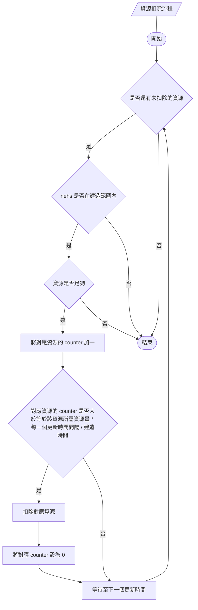
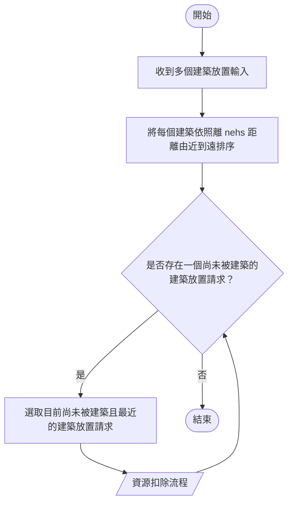
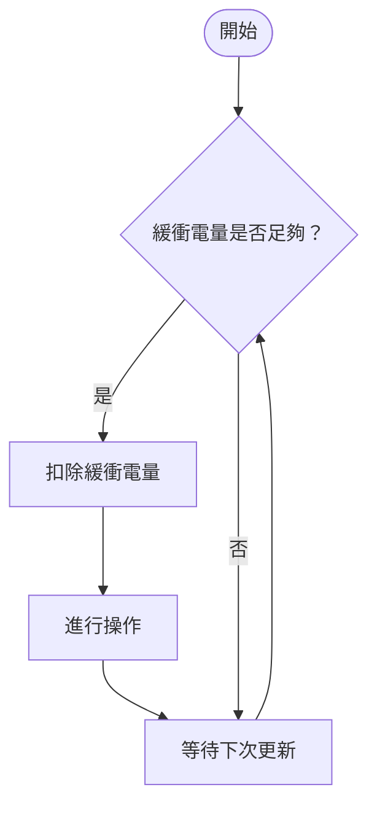
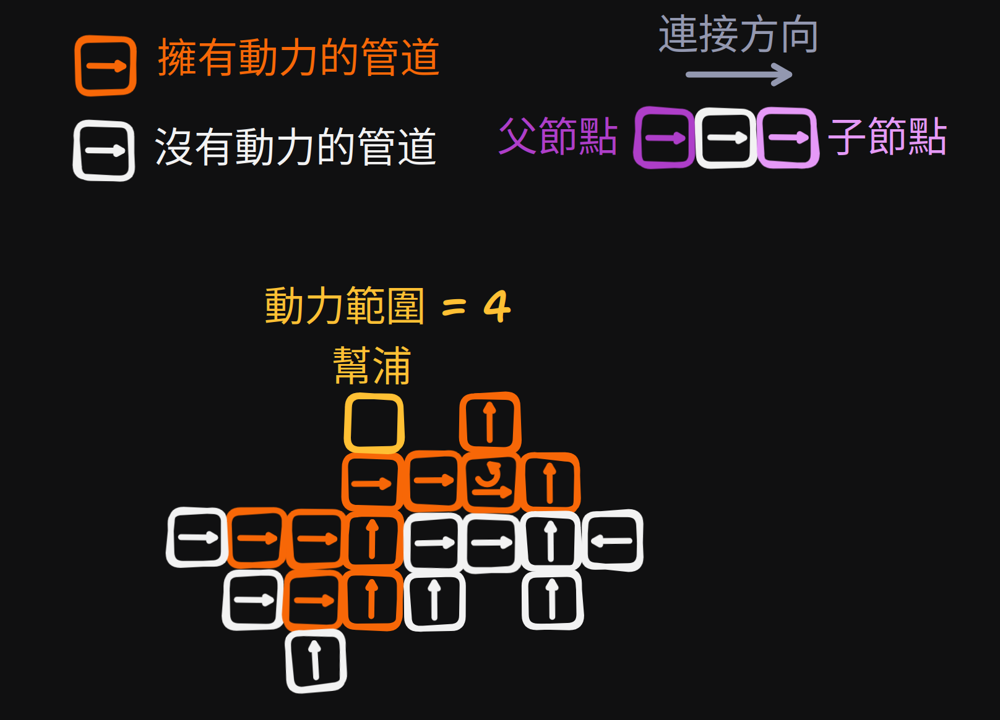
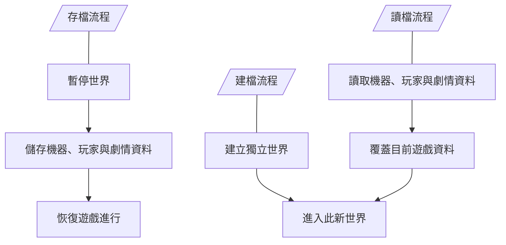
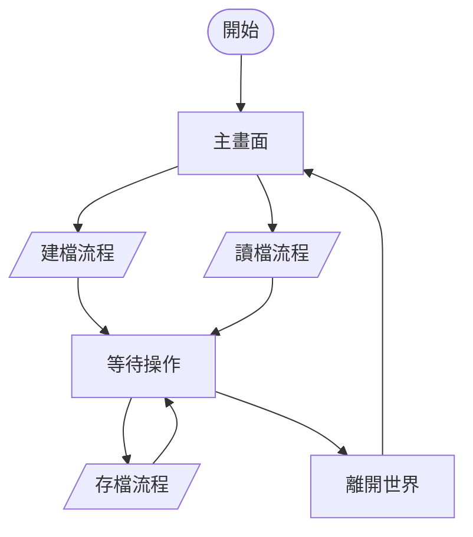

---
puppeteer:
  format: A4
  timeout: 10000
---

# 遊戲規則

## 滑鼠與鍵盤操作

在本專案中，描述鍵盤與滑鼠移動的名詞定義如下：

### 滑鼠

| 定義 | 解釋 |
| --- | --- |
| `左鍵` | 按下滑鼠左側按鍵 |
| `右鍵` | 按下滑鼠右側按鍵 |
| `鬆開` | 按下滑鼠按鍵後回彈的動作 |
| `左鍵單擊` | 快速按下`左鍵`並`鬆開`的動作 |
| `左鍵長按` | 按下`左鍵`，停在原地並等待的動作 |
| `左鍵拖曳` | 按下`左鍵`並移動滑鼠的動作 |
| `右鍵單擊` | 快速按下`右鍵`並`鬆開`的動作 |
| `右鍵長按` | 按下`右鍵`，停在原地並等待的動作 |
| `右鍵拖曳` | 按下`右鍵`，停在原地並等待的動作 |

### 鍵盤

| 定義 | 解釋 |
| --- | --- |
| `大寫英文字母` | 按下此字母按鍵的動作，不代表需要按下 `英文字母 + shift` 的操作 |
| `數字` | 按下此`數字`按鍵的動作 |
| `Space` | 按下空格鍵的動作 |
| `Shift` | 按下 shift 按鍵的動作 |
| `Ctrl` | 按下左側或右側 ctrl 按鍵的動作 |

## 玩家移動

### 玩家移動定義

`玩家移動`由下列五種按鍵構成：

| 按鍵 | 行為 |
| --- | --- |
| `W` | 地圖位置之於玩家向下運動，而玩家固定在視角中間 |
| `A` | 地圖位置之於玩家向右運動，而玩家固定在視角中間 |
| `S` | 地圖位置之於玩家向上運動，而玩家固定在視角中間 |
| `D` | 地圖位置之於玩家向左運動，而玩家固定在視角中間 |
| `Shift` | 依照此時玩家方向，地圖位置之於玩家向玩家朝向之反向快速移動 |

以下是本專案將會使用到的名詞定義：

| 名詞 | 定義 |
| --- | --- |
| `移動按鍵` | `W, A, S, D` 按鍵執行移動 |
| `衝刺按鍵` | `Shift` 按鍵執行加速 |
| `移動輸入` | 按下`移動按鍵`或是`加速按鍵` |
| `單方向移動` | 只按下單個`移動按鍵`的移動過程 |
| `斜向運動` | 同時按下多個`移動按鍵`的移動過程 |
| `移動加速度` | 按下或`鬆開` `移動按鍵`時，玩家所增加或減少的加速度 |
| `衝刺初速度` | 按下或`鬆開` `加速按鍵`時，玩家的速度量值設定值 |

### 玩家移動規則

- 按下`移動按鍵`時，玩家立刻開始加速移動直至`終端速度`。
- `鬆開` `移動按鍵`時，玩家立刻根據地形減速移動直到停止。
- `斜向運動`時的`終端速度`與`單方向運動`的`終端速度`相同。
- `斜向運動`時的`終端速度`與`單方向運動`的`終端速度`相同。
- `斜向運動`時的加速度增加量值與`單方向運動`的加速度增加量值相同。
- 按下`加速按鍵`時，玩家的移動速度立即被設為 $v_s$ 並以地形賦予的減速度減速至`終端速度`。
- 玩家無法穿過具有碰撞的地形與建築。
- 死亡期間不接受`移動輸入`。
- 劇情期間可否移動由劇情決定。
- 恢復操作時，依照當時玩家按下的`移動按鍵`與`加速按鍵`開始移動。

## 玩家互動

### 玩家互動定義

`玩家互動`包括：

- 拾取物品。
- 開啟與 NPC 的對話。
- 結束劇情播放時的打字機文字浮現效果。
- 跳過劇情播放時預先設計的等待或停頓。

`玩家互動`僅有`F`鍵。

### 玩家互動規則

- 死亡期間不接受`玩家互動`。
- 劇情期間可否互動根據劇情決定。
- 進入`建築模式`時，不接受`玩家互動`。
- 恢復操作時，即使按住`F`鍵也不會觸發互動，必須`鬆開` `F`鍵後才會真正恢復。

## 建築模式

### 建築模式定義

`建築模式`為興建建築或是拆除建築的先備動作。

有兩種方式可以觸發`建築模式`：

| 按鍵 | 行為 |
| --- | --- |
| `B` | 開啟或關閉`建築模式` |
| `左鍵` 選取或取消選取建築選單中的建築 | 開啟或關閉`建築模式` |

### 建築模式規則

- 死亡期間，`建築模式`自動切回不開啟。
- 劇情期間可否建築根據劇情決定。
- 恢復操作時，`建築模式`自動切回不開啟。

## 建築放置

### 建築放置定義

`建築放置`在開啟`建築模式`後才可操作。

在開啟`建築模式`並且選取建築之後，若擺放的位置符合規則，`左鍵`會新增建築放置請求。

有部份建築只能放置在特定區域。

每種建築皆有兩個參數：

| 參數 | 意義 |
| --- | --- |
| `所需資源` | 建造一個建築所需的資源 |
| `建造時間` | 建造一個建築所需的時間 |

每一個`建築放置請求`的資源扣除流程如下：

收到多個`建築放置請求`後的檢查與資源扣除流程圖如下：

### 建築放置規則

- 若`建築放置`區域內有不可覆蓋的物體或建築物，`左鍵` 後不會建築。
- 死亡期間，不接受放置輸入。
- 劇情期間可否建築根據劇情決定。
- 恢復操作時，`建築模式`自動切回不開啟。
- 鑽機類`建築放置`時，須確認其下方是否有礦石，才可放置；礦機底部只要有部份區域與礦石重疊即可放置。

## 建築拆除

### 建築拆除定義

`建築拆除`再開啟`建築模式`後才可操作。

在開啟`建築模式`後，若符合規則，`右鍵`會開始拆除。

### 建築拆除規則

- 若`右鍵`時，滑鼠位置下並沒有可以拆除的建築，則拆除不會執行。
- 死亡期間，不接受放置輸入。
- 劇情期間可否建築根據劇情決定。
- 恢復操作時，`建築模式`自動切回不開啟。

## 漂浮建築限制

### 漂浮建築定義

建築物可根據`建築放置規則`建造在水中，而建造完後會根據建築類型而有不同的行為。

使用氣囊，可以讓原本會沉入水中並可以漂浮的建築類型漂浮在水中。並可透過選取功能，一併移動可以移動的建築。

### 漂浮建築規則

- 不同建築類型與其放置後行為如下表：

| 放置後行為 | 建築類型 |
| --- | --- |
| 漂浮至水面 | 太陽能球 |
| 漂浮在水中 | 管線、幫浦、電塔（大型電塔不可漂浮）、各類魚雷、水雷、機器人 |
| 下沉至海底 | 其餘建築與道具 |

- 可以使用氣囊使其漂浮的建築如下：

| 漂浮限制 | 建築類型 |
| --- | --- |
| 不可使用器囊 | 鑽機類、管線、幫浦、電塔（大型電塔可以漂浮）、各類魚雷、水雷、機器人、各類礦石、各類加工產物 |
| 可以使用氣囊 | 其餘建築 |

- 每一個由建築與氣囊組成的連通塊，會計算氣囊浮力與上方建築的重量，若浮力小於重量，則會使整個連通塊下墜並對下方建築或敵人造成傷害。

## 選取系統

### 選取系統定義

當進入`建築模式`並且未選擇任何建築時，`右鍵拖曳`便會開始框選建築與道具，`鬆開` `右鍵`後完成選取。

以下是本系統使用的名詞：

| 名詞 | 定義 |
| --- | --- |
| `選取框` | 從`右鍵`按下位置至目前滑鼠位置形成的矩形區域 |
| `選取群組` | 本次選取的建築與道具集合 |
| `移動預覽` | 顯示`選取群組`移動後的位置，以及是否符合移動條件 |

選取完成後，`左鍵單擊` `選取群組`中的任一物件可開始`移動預覽`；再次`左鍵單擊`確認移動，`右鍵單擊`取消`移動預覽`，`Esc`取消選取。

### 選取系統規則

- 選取只在開啟`建築模式`且未選擇建築選單中的建築時可操作。
- 框選期間顯示`選取框`；`鬆開` `右鍵`時，將中心點位於`選取框`內且可選取的建築與道具加入`選取群組`。
- 每次框選取代原有選取；框選範圍內沒有可選取物件時，清除原有選取。
- 被選取的建築與道具須以外框或其他方式明確標示；不可移動的物件須額外標示原因。
- 選取本身不會暫停建築運作、資源運輸或漂浮與下墜。
- `移動預覽`期間，物件仍留在原處並維持原有行為；預覽不占用空間，也不改變設備連接關係。
- 移動時，`選取群組`內各物件的相對位置與朝向保持不變。
- 確認移動前，須依當下狀態檢查所有物件的位置是否合法，包括地形、碰撞、各類建築的放置限制，以及管線是否形成有向環路；檢查碰撞時，不將群組內物件移動前的位置視為障礙。
- 群組內存在不可移動的物件，或任一物件不符合移動條件時，整次移動不執行，並標示不符合條件的物件與原因。
- 移動成功時，保留各物件的血量、暫存資源、電量與工程進度；不視為拆除或重新建造，不重新扣除建造資源。
- 移動後，依新位置重新計算`電網`、運輸連接、幫浦`動力範圍`，以及`漂浮建築`與氣囊的連通關係；浮力不足時依`漂浮建築規則`下墜。
- 選取期間若有物件被拆除或破壞，將其移出`選取群組`並取消目前的`移動預覽`；群組內已無物件時，自動取消選取。
- 關閉`建築模式`、選擇建築選單中的建築、玩家死亡、進入禁止建築的劇情或`讀檔`時，取消選取與`移動預覽`。
- 恢復操作時，須先`鬆開`滑鼠按鍵，再重新按下，才可觸發選取、移動或拆除。

## 資源採集

### 資源採集定義

NEHS 本身、可以採集部份礦物，而其餘礦物則需要建造鑽機來獲取。

各種資源的取得方式如下表。

| 工具 | 銅 | 鐵 | 水晶 | 金 | 鈦 | 稜晶 | 緻密石英 | 鈾 | 璇璣玉 | 水趺礦 |
| --- | --- | --- | --- | --- | --- | --- | --- | --- | --- | --- |
| nehs | v | v | v | | | | | | | |
| 鑽機 | v | v | v | | | | | | | |
| 光能鑽機 | v | v | v | v | v | | | | | |
| 電動鑽機 | | | | v | v | v | v | | | |
| 爆破鑽機 | v | v | v | v | v | v | v | v | v | v |

開採礦物時，每產出一個礦物，都有其所需的時間，這段時間在本文稱作`開採進度`。

### 資源採集規則

- 當使用 nehs 採集時，nehs 的其他工程將會暫停。
- 當取消 nehs 採集時，會使本次`開採進度`淸零。
- 在鑽機運作時拆除鑽機，會使鑽機內暫存的礦物被拋棄。
- 在鑽機運作時被破壞，會使鑽機內暫存的礦物被拋棄。

## 資源加工與合成

### 資源加工與合成定義

nehs 與加工機器皆可進行`資源加工與合成`，而欲從礦物加工與合成至一個目標材料皆有其所需時間，這段時間在本文稱作`加工進度`。

不同的加工機器可以加工出不同的材料，具有專一性。

### 資源加工與合成規則

- 當 nehs 加工與合成時，若有其他優先級更高的工程，則加工會被暫停，目前的`加工進度`不會捨棄。
- 當取消 nehs 加工與合成時，會使本次`加工進度`淸零。
- 當加工機器運作時被拆除，會使加工機器內暫存的材料被拋棄。
- 當加工機器運作時被破壞，會使加工機器內暫存的材料被拋棄。

## 電力系統運作規則

### 電力系統定義

`電力系統`由電塔、發電機、電池與耗電機器組成。每種發電機都會由不同方式產生電力，並透過電塔連接，電池與耗電機器儲存部份多餘電能，最後由耗電機器消耗電量。

以下是本專案將會使用到的名詞定義：

| 名詞 | 定義 |
| --- | --- |
| `電網` | 每一個由電塔連接的電塔、發電機、電池與耗電機器所構成的連通塊 |
| `緩衝電量` | 每一台耗電機器可儲存並供自己使用的電量 |
| `儲存電量` | 每一個發電機與電池可儲存並供`電網`使用的電量 |
| 參數 | 意義 |
| --- | --- |
| `發電功率` | 目前`電網`連接的發電機總`發電功率` |
| `耗電功率` | 目前`電網`實際供給耗電機器充電的總功率，不包含機器操作時從自身`緩衝電量`扣除的電量 |
| `儲存電量上限` | 目前`電網`連接的發電機與電池可儲存的電量上限總和，不包含耗電機器的`緩衝電量` |

若以 $P_\text{g}(t)$ 代表`發電功率`，$P_\text{c}(t)$ 代表 `耗電功率`，$E_\text{max}(t)$ 代表`儲存電量上限`，$E_\text{k}(t)$ 代表目前電量，$\Delta t_k$ 為每次更新的時間間隔，其中 $t$ 為時間，以秒為單位，則`電網`的電力變動可以寫成：

$$
E_\text{k}(t + \Delta t_k) = \text{clamp}(E_k(t) + (P_\text{g}(t) - P_\text{c}(t)) \times \Delta t_k, 0, E_\text{max}(t))
$$

定義限制函數 $(\operatorname{clamp}:\{(k,l,r)\in\mathbb R^3\mid l\le r\}\to\mathbb R)$ 為：
$$
\operatorname{clamp}(k,l,r)
=\min\{r,\max\{l,k\}\}
$$

每一台耗電機器皆有三種與電力相關的參數：

| 參數 | 意義 |
| --- | --- |
| `充電功率` | 耗電機器每秒可從`電網`中吸取的電量上限 |
| `每次操作耗電量` | 耗電機器進行每次操作時所需的電量 |
| `緩衝電量` | 如上名詞定義所述 |

耗電機器的耗電流程如以下流程圖：

### 電力系統規則

- 電塔依照各自的連接範圍連接其他電塔、發電機、電池與耗電機器；彼此連通的設備屬於同一個`電網`，不同`電網`之間不交換電量。
- 發電機須符合各自的發電條件才會產生電力；條件不符時停止發電，但已持有的`儲存電量`仍可供`電網`使用。
- 發電時優先供應耗電機器充電，剩餘電量存入同一`電網`的發電機與電池；達到`儲存電量上限`後，多餘電量不再保留。
- 發電不足以供應耗電機器充電時，使用同一`電網`的`儲存電量`補足；`電網`可供應的電量不得小於零。
- 耗電機器未達`緩衝電量上限`時，才會向`電網`要求充電。每次更新要求的電量不得超過`充電功率`乘以更新時間間隔，也不得超過`緩衝電量`的剩餘容量。
- `電網`可供應的電量不足時，依各台耗電機器本次要求充電量的比例分配，並以實際供應的電量計算`耗電功率`。
- 充入耗電機器的電量只計入該機器的`緩衝電量`，不再計入`電網`的`儲存電量`，也不會回供`電網`或其他機器。
- 耗電機器開始每次操作前，須確認`緩衝電量`是否足夠支付`每次操作耗電量`；足夠時立即扣除該次所需電量，才開始操作。
- `緩衝電量`不足時，耗電機器等待充電，不開始新的操作；已扣除電量並開始的操作不因`電網`缺電或斷線而中止。
- 耗電機器因缺少材料、產物暫存空間不足或其他條件而無法操作時，不扣除`每次操作耗電量`，但仍可充電至`緩衝電量上限`。
- 耗電機器與`電網`斷線後，無法繼續充電，但仍可使用自身剩餘的`緩衝電量`操作；重新連接後自動恢復充電。
- `建築放置`、拆除、被破壞或移動而改變連接關係時，須在下次電力更新前重新計算`電網`及其參數。
- `電網`合併時，各設備保留自身電量，合併後的`儲存電量`與`儲存電量上限`分別為各設備對應數值的總和。
- `電網`拆分時，各設備保留自身電量，各新`電網`只計入仍與其連接的設備，不依拆分前的總電量重新平均分配。
- 放置新的發電機、電池或耗電機器時，其`儲存電量`或`緩衝電量`皆從零開始；透過選取功能移動既有設備時保留電量。
- 發電機、電池或耗電機器被拆除或破壞時，該設備持有的`儲存電量`或`緩衝電量`被拋棄，不轉移至其他設備。

## 運輸系統運作規則

### 運輸系統定義

一個`運輸系統`由連接的管線、幫浦、輸出資源的機器與接收資源的機器組成。

幫浦具有一個參數：`動力範圍`，當附近的管線連接且與幫浦相靠，則所有距離幫浦小於等於`動力範圍`的管線皆可有動力。

此處的距離可以定義成：將每一個管道視為節點，並以連接方向建立有向邊，則一個`運輸系統`將會形成一個有向無環圖。若把與幫浦相連的節點（管道）的距離設為 1。設這些初始點為 $v_i$，則 $v_i$ 的父節點與子節點 $v_p, v_c$ 的距離就會是 $v_i$ 的距離加一，遞迴計算。若有節點被重複計算，則此節點的距離會是所有結果的最小值。如下圖所示。

每個管線皆有三個參數：

| 參數 | 意義 |
| --- | --- |
| `資源容量` | 每個管道可以暫存在管道內的資源量 |
| `運輸方向` | 以 4 + 4 個 bit 為編號，前四位為接收端，後四位為輸出端，分別以 0 與 1 標記 |
| `動力來源` | 以幫浦編號標記可以為此管道提供動力的幫浦 |

### 運輸系統規則

- 管線須依輸入端與輸出端的方向連接，資源只能由輸出端送往下一段管線或接收機器的輸入端，不可反向輸送。
- 管線與機器僅相靠但未連接對應端口時，不交換資源；不同`運輸系統`之間也不交換資源。
- 放置、轉向或移動管線時，若新的連接會使管線形成有向環路，則該次操作不執行。
- 幫浦的`動力範圍`依管線連接距離計算，不以畫面上的直線距離計算；與幫浦相連的管線距離為 1，每經過一段相連管線，距離加一。
- 計算幫浦的`動力範圍`時，可沿管線的父節點與子節點向外搜尋，並取最短距離；此搜尋方向不改變資源的輸送方向。
- 管線須位於至少一台可運作幫浦的`動力範圍`內才可輸送資源。未獲得動力時，管線內的資源留在原處，也不接受新的資源。
- 多台幫浦的`動力範圍`可以共同覆蓋一條運輸路線，但不會把各自的`動力範圍`相加；沒有動力的管線也不會因上下游有動力而自動獲得動力。
- 管線只接受自身種類可輸送的資源，接收機器也只接受其用途或目前配方所需的資源；不符合條件時，資源留在原輸出端。各類管線可輸送的資源依`資源與道具表.md` 設定。
- 每段管線與每台機器皆有各自的暫存容量，輸送時不得超過接收端的剩餘容量，也不得超過輸出端實際持有的資源量。
- 每次轉移資源前，須同時確認輸出端持有資源、相關管線具有動力、輸送進度完成，以及接收端可接受該資源且仍有空間；條件皆符合才執行轉移。
- 資源成功轉移時，須從輸出端扣除相同種類與數量的資源，再存入接收端；同一份資源不可同時存在於兩端，也不可在同一次運輸更新中連續通過多段管線。
- 接收端已滿、未連接或不接受該資源時，資源留在目前的管線內等待，不會被拋棄；暫存空間用盡後，停止接受上游資源，直到再次有空間。
- 同一段管線內的資源依進入順序輸出，後進入的資源不可越過前方等待中的資源。
- 分流時，以每次一份資源的方式，依固定順序輪流送往符合輸送條件的輸出端；暫時無法接收的輸出端跳過，所有輸出端皆無法接收時則等待。
- 匯流時，接收端以每次一份資源的方式，依固定順序輪流接受符合輸送條件的輸入端，並在每次接收後更新剩餘容量，避免多個輸入端同時占用同一份空間。
- 機器因缺少材料或產物暫存空間不足而停止生產時，管線仍可依剩餘容量輸入材料或取出產物；是否可交換資源不以機器是否正在生產判定。
- 需要耗電的運輸設備依`電力系統規則`充電與操作；缺電而無法開始新的輸送操作時保留資源，恢復供電後自動繼續。
- 管線或幫浦被放置、拆除、破壞、轉向或移動而改變連接關係時，須在下次運輸更新前重新計算連接關係、幫浦距離與動力覆蓋。
- 運輸路線斷開時，尚存設備內的資源保留在原處；重新連接且符合輸送條件後，自動恢復輸送，不會直接轉移至斷點另一側。
- 放置新的運輸設備時，其暫存資源從零開始；透過選取功能移動既有設備時保留其暫存資源，移動後依新的連接關係判定是否可繼續輸送。
- 運輸設備被拆除或破壞時，該設備內暫存的資源被拋棄，不轉移至相鄰設備；輸出機器與接收機器內的資源則依各自的拆除與破壞規則處理。

## 友方機器人

### 友方機器人定義

由我方工廠製造並可以控制的機器人為`友方機器人`。

每個機器人皆可由玩家控制行為，每台機器人皆有以下行為：

| 行為 | 定義 |
| --- | --- |
| `移動至指定位置` | 可由玩家選取，並點擊地圖後移動到點擊位置 |
| `自爆回收` | 可由玩家決定自爆，並由 nehs 回收資源再利用 |

而不同機器人有其特定的行為。

### 友方機器人規則

- `友方機器人`的種類、用途與製造配方依`資源與道具表.md`設定；`功能機器人`與`攻擊機器人`為雛型，不直接具有各專用機型的採礦、保衛、治療或攻擊能力。
- 工廠完成製造後，須在可容納該機器人的位置釋出，才開始接受指令；出口被阻擋時，成品留在工廠內等待，不與既有物體重疊，也不因等待而重複產出。
- 玩家可對選取的`友方機器人`下達指令；一次選取多台時，各台分別判斷是否可執行，不符合機型用途的指令不執行，也不影響其他機器人。
- 每台機器人同時只執行一個主要指令；收到新的有效指令時取代原指令。已完成的資源轉移、已發射的魚雷與已造成的傷害不因更換指令而撤回。
- 執行`移動至指定位置`時，機器人須沿可通行路線移動，不可穿過具有碰撞的地形與建築；在水中依原有漂浮規則移動，不使用氣囊。
- 指定位置無法容納機器人或不存在可通行路線時，該次移動指令不執行；移動途中路線受阻時重新尋路，仍無路可走則停留等待，不直接傳送至目標位置。
- 多台機器人前往同一位置時，依各自可容納的位置在目標附近停留，不要求全部重疊在同一點。
- 玩家指定的移動優先於自動採礦、修復與攻擊；移動期間不因附近出現工作目標而自行偏離路線。到達後，各機型才依自身用途尋找有效目標。
- 自動行為只能選擇各機型偵測範圍內、可到達且符合用途的目標；目前目標仍有效時持續處理，不在每次更新時反覆切換目標。目標消失、耗盡或不再符合條件時，才重新選擇。
- 同時存在多個有效目標時，優先選擇距離最近者；距離相同時依固定順序選擇。沒有有效目標時原地等待，不憑空產生礦物、修復量或攻擊效果。

各專用機型的行為與限制如下：

| 機型 | 行為與限制 |
| --- | --- |
| `採礦機器人` | 只開採該機型可採集的礦物，完成一次`開採進度`後才取得對應礦物，並存入自身暫存空間；容量不足時停止開始新的採集。取消或更換採集目標時，本次尚未完成的`開採進度`淸零，已採得礦物保留。 |
| `貼身保衛機器人` | 沒有玩家指定的移動指令時跟隨主角，優先攔截可抵禦且朝向主角的攻擊；只有成功攔截的攻擊才由`保衛機器人`承受，未攔截的攻擊仍依原規則判定主角是否受傷。 |
| `治療機器人` | 自動選擇受損的友方機器進行修復，進入修復範圍並符合`所需資源`與電量條件後才增加目標血量；血量不得超過上限，也不可修復已被破壞的目標。 |
| `電擊機器人` | 敵人位於電弧攻擊範圍且符合攻擊條件時，消耗該次所需電量後產生電弧；電量不足時不發動攻擊，也不造成傷害。 |
| `魚雷機器人` | 從`魚雷拾取台`取得可使用的魚雷，並在敵人符合發射條件時消耗攜帶的魚雷進行攻擊；沒有魚雷時不能發射，發射後的效果依魚雷種類判定。 |
| `衝擊機器人` | 沿可通行的直線路徑加速衝向敵人，實際碰撞且符合該機型的速度條件時才造成暈眩；受到地形或建築阻擋時停止衝擊，不使阻擋物後方未被碰撞的敵人暈眩。 |

- `充電台`依`電力系統規則`取得電量，機器人位於其充電範圍且仍有電量容量時才可充電；實際充入機器人的電量須從`充電台`扣除，不能同時保留在兩端。機器人離開充電範圍或`充電台`無電時停止充電，已充入的電量保留。
- 機器人執行耗電操作前，須先確認並扣除該次所需電量；已扣電並開始的操作不重複扣電，電量不足時不開始新的耗電操作，也不因缺電而清除攜帶資源。
- `魚雷拾取台`只提供台內實際持有且該機型可使用的魚雷；拾取時不得超過機器人的剩餘攜帶容量。多台機器人同時拾取時，須逐次扣除台內庫存，避免同一枚魚雷被重複取得。
- 攻擊須依各機型的操作時間或冷卻間隔進行；目標離開範圍、已被破壞或其他攻擊條件不符時，不開始新的攻擊，也不預先扣除尚未使用的魚雷。
- `友方機器人`受到傷害時減少自身血量，血量小於等於零時被破壞並停止所有行為；被破壞不視為`自爆回收`，其暫存礦物、魚雷與剩餘電量被拋棄，不自動加入玩家資源。
- 執行`自爆回收`後，機器人停止原指令並移除，依該機型設定在原位置留下可由 nehs 回收的資源；尚未完成的採集、修復與攻擊不結算成果，也不觸發攜帶魚雷的發射效果。
- `自爆回收`產生的資源與機器人原本攜帶的礦物、魚雷分別計算，攜帶物留在原位置等待回收；剩餘電量不轉換成資源，也不回供`電網`。同一台機器人只能結算一次回收資源。
- nehs 須實際到達可回收範圍才可取得回收資源；回收前資源留在世界中，不直接存入庫存，也不使機器人重新出現。
- 玩家死亡期間不接受新的機器人指令，既有機器人仍依原指令與世界狀態運作；`貼身保衛機器人`在主角死亡後停止跟隨，重生後再依可通行路線前往主角位置。
- 劇情期間可否下達指令及機器人是否繼續運作由劇情決定；恢復操作時不重播暫停期間的滑鼠輸入。世界暫停時，機器人的移動、採集、修復、攻擊與充電進度皆暫停。
- `存檔`須保留各機器人的種類、位置、血量、電量、攜帶資源、目前指令、目標、操作進度與冷卻狀態，以及尚未被回收的資源；`讀檔`後重新確認目標與路線是否有效，不重複產出、扣電、發射魚雷或結算`自爆回收`。

## 玩家死亡與重生規則

玩家具有血量，以等級決定。每種對玩家的攻擊若成功會造成傷害並減少血量。若血量小於等於零，則會死亡。

劇情播放過程中，玩家不會受到傷害，其餘時間皆有可能死亡並重生。

遊戲過程中會有隨遊戲進度開放的重生點，並在每次死亡後，由 nehs 修復並重生。

## 死亡與重生的世界觀合理性

nehs 會在沿途尋找資源充沛的地方，並設立安全的重生點。若主角死亡，則 nehs 會抱著主角的殘骸回到上一個重生點，並消耗 nehs 內部能量進行修復。

## 建檔、存檔與讀檔機制

### 建檔、存檔與讀檔定義

遊戲`存檔`以`世界存檔`為基礎，也就是建立新檔時，每次都是獨立的新世界。`存檔`時，則會覆蓋此世界的遊戲進度。`讀檔`時，則會從上次`存檔`的進度出發，繼續遊玩此世界。

每次建立新檔、`存檔`與`讀檔`的流程如下：

遊戲進行時的`建檔`、`存檔`與`讀檔`如下：

### 建檔、存檔與讀檔規則

- 每次`建檔`皆建立獨立的世界與`存檔`，不沿用其他世界的玩家、資源、建築或劇情進度，也不覆蓋其他世界的`存檔`。
- 新世界的地圖、玩家、nehs、資源、建築、劇情與重生點皆依遊戲初始設定建立；完成初始化並成功儲存初始`存檔`後，才進入新世界。
- `存檔`只覆蓋目前世界的遊戲進度，不影響其他世界；`讀檔`只還原所選世界，不將目前世界的資源或進度帶入。
- `存檔`時須先暫停世界，停止移動、戰鬥、建造、採集、加工、電力、運輸與劇情等更新，再儲存同一個時間點的完整狀態；`存檔`完成後恢復`存檔`前的暫停或執行狀態。
- `存檔`須保留世界的地圖變化、遊戲內時間、已存在的建築與道具，以及影響後續遊戲進行的敵人與 NPC 狀態。
- 玩家與 nehs 的位置、朝向、血量、等級、持有資源與道具、目前工程及其進度皆須保留；已開放的重生點與目前使用的重生點也須保留。
- 尚未完成的`建築放置請求`須保留建築種類、位置、已扣除與尚未扣除的資源，以及各資源的 `counter`；`讀檔`後依 nehs 的位置與原有`建築放置規則`繼續處理，不重新扣除已支付的資源。
- 採集與加工須保留目前目標或配方、已投入材料、暫存礦物與產物，以及`開採進度`與`加工進度`；`存檔`與`讀檔`不視為取消工程、拆除或破壞，不使進度淸零或拋棄暫存資源。
- 電力設備須分別保留各自的`儲存電量`與`緩衝電量`；已支付`每次操作耗電量`的操作須保留其進度，`讀檔`後繼續該次操作時不重複扣電。
- 運輸設備須保留位置、方向、暫存資源的種類、數量與進入順序、輸送進度，以及分流與匯流的輪流順序；同一份資源在`存檔`中只能歸屬一個設備，不得因`讀檔`而重複或消失。
- `漂浮建築`與氣囊須保留各自的位置及影響後續移動的狀態；`讀檔`後仍依浮力、重量與連接關係判定漂浮或下墜，不自動移回放置時的位置。
- 劇情須保留已觸發與已完成的事件、目前播放位置及尚未結束的等待狀態；`讀檔`不重複發放已領取的劇情資源或道具，也不重複開放已解鎖的內容。
- 死亡與重生期間`存檔`時，須保留死亡或修復中的狀態及其進度；`讀檔`不直接恢復存活，也不跳過尚未完成的重生流程。
- `存檔`暫停期間、`讀檔`期間與離開世界期間不計入遊戲內經過時間，不增加建造、採集、加工、充電、運輸或重生進度，也不推進劇情。
- `讀檔`時須先完整讀取並確認`存檔`可用，才覆蓋目前遊戲資料；`存檔`不存在、資料不完整或版本不相容時，須提示失敗原因，不進入部份還原的世界。
- `讀檔`完成後，須在恢復世界更新前，依還原的設備位置與方向重新計算`電網`、運輸連接、幫浦距離與動力覆蓋，以及`漂浮建築`的連通關係；重新計算不得改變各設備原本持有的資源與電量。
- `讀檔`後，各工程與設備依還原後的狀態及原有規則判定是否繼續運作；缺少資源、電量、動力或接收空間時仍須等待，不因`讀檔`而跳過操作條件。
- `存檔`與`讀檔`期間不接受遊戲操作輸入；恢復操作時，移動依當時按下的`移動按鍵`與`加速按鍵`處理，`F`鍵須`鬆開`後才可再次互動，`建築模式`自動切回不開啟。
- 建築選單中的選擇、尚未送出的建築操作與滑鼠按住狀態不作為工程進度還原；`讀檔`後須重新操作才可觸發`建築放置`、拆除或選取。
- 新`存檔`完整寫入並確認成功後，才可取代上一次成功的`存檔`；`存檔`失敗時須提示玩家並保留上一次成功的`存檔`，不將失敗的結果標示為已儲存。
- 離開世界時若有尚未儲存的進度，須讓玩家選擇`存檔`後離開、放棄未儲存進度後離開，或取消離開；選擇`存檔`後離開但`存檔`失敗時，須留在目前世界。
