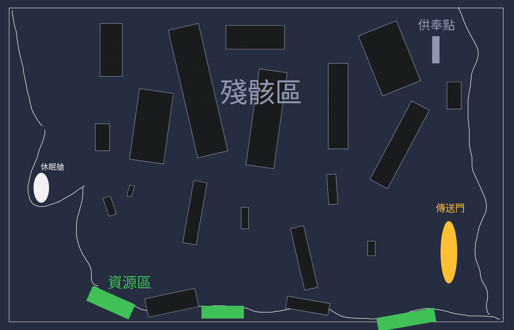
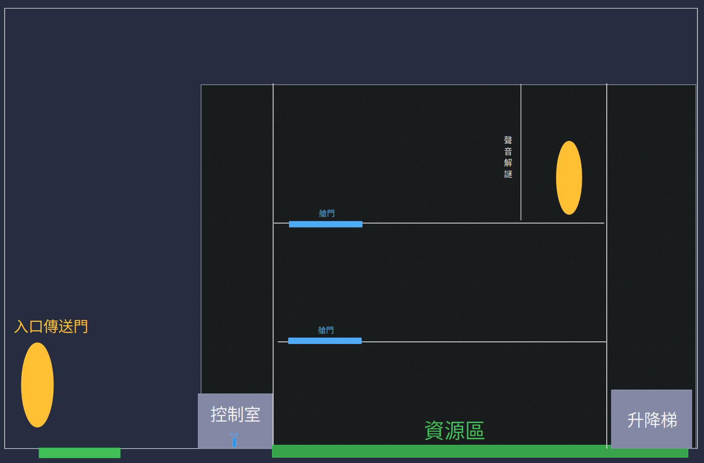
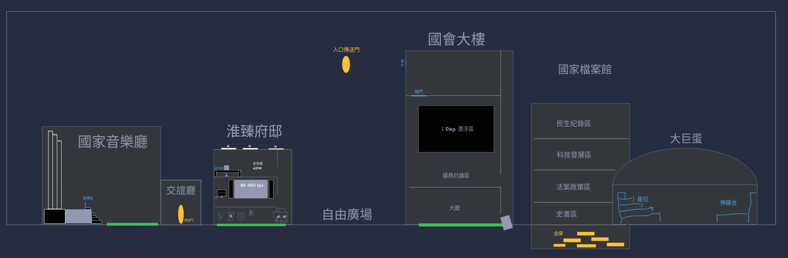
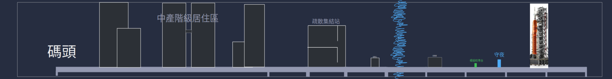
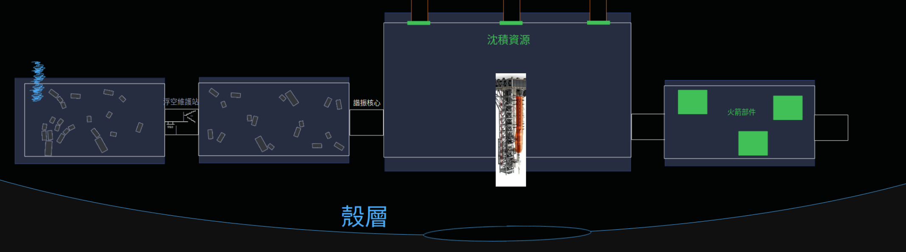

# 數位遊戲設計規格書

## 遊戲名稱

## 開發者／開發團隊

## 第一部分：遊戲設計（Concept Design）

### 遊戲背景故事與世界觀

206 年前，有一位科學家研製出一種液體叫做 `遊耀垣` ，可以吸收衝擊力並能選擇性組隔電磁波。於是，借助當時的反重力技術，`渾天`文明在這個星球上空覆蓋了此液體，讓此文明在黑暗森林宇宙中得以存活。但，由於計算失誤，有一塊懸浮液體墜落，導致反重力裝置受損，連帶使大部分的 `遊耀垣` 液體墜落，毀滅星球表面的建築物。為了文明延續，`渾天`文明在遭受 `遊耀垣` 液體摧毀前，從人民中選擇了 44 為 `窺辰者`，躺入休眠倉並進入太空，期望在[星球名]星球重新落地生根。當然，過程中有發射失敗的休眠倉，最終墜毀在星球上。不過，現在你是唯一在發射失敗的休眠倉甦醒的倖存者，而你失憶了（所以他不知道上面的劇情）。而你注意到，天空上有一塊奇怪的水，因此，你想看看上頭有什麼。

### 遊戲地圖

#### 第一關 星海變奏的序曲

- 遺跡:一切開始的地方
- 地圖概述:以墜毀的休眠倉為中心、向外擴張的教學地圖,分成由近到遠的四個區域,隨探索度逐區開放。
  - 地點配置:
    - 墜落坑與休眠倉:起點,艙門自動開啟,周圍是殘骸與倒塌的支架。
    - 殘骸帶:可撿拾基礎材料;超強怪物在此出現,玩家無法正面對抗,需在 nehs 協助下逃離。
    - 資源區:礦石、水源等基礎原料,供工廠初體驗使用。
    - 供奉點:供奉系統的互動地點,隨探索度與供奉等級提升。
    - 第一座工廠基地:輸送帶、加工機、組裝機的教學場地。
    - 傳送門預定建造地:地圖最遠端,與超強怪物決戰的地點。

#### 第二關 彼時鐘擺的殘響

- 遺跡:反重力裝置實驗局
- 地圖概述:垂直發展的三層研究設施,以升降梯與可上升的控制室作為上下連接。
  - 地點配置:
    - 入口大廳:觸發警報,出入口被鎖死,玩家被困。
    - 第一層(控制室、實驗室):控制室是據點,實驗室內有實驗記錄(OLED 或 MINI-LED 螢幕)。
    - 升降梯:故障,修復後才能前往第二層。
    - 第二層:控制室自動上升到此層,內有搭載 M6 的 cam mini 電腦與機器人 NPC。
    - 第三層(生物實驗區):有一條作為實驗品的魚,為本關 Boss。
    - 鐘聲機關室:放入權限卡後啟動鐘聲,進行聲音解謎。

#### 第三關 窺管向辰的悲鳴

- 遺跡:首都(國會、國家檔案庫、淮臻府邸、國家音樂廳、瀟邦大巨蛋)
- 地圖概述:以自由廣場為中樞、向外放射的城市地圖,主線為四個地點,另有一個支線地點。
  - 地點配置:
    - 自由廣場:傳送門抵達點與各地點的集合處。
    - 國會:漂浮的 iDap Pro 顯示渾天計畫議定書與票選紀錄;場內有被扯下的國旗標、斷掉的天秤與議員名冊。
    - 國家檔案庫:存放渾天計畫中止草案與淮臻首相的簽名。
    - 淮臻府邸:內有 GOR 筆電、逃生倉操作手冊與犯罪筆記(淮臻與皓En)。
    - 國家音樂廳:大廳座椅長滿海草,節目單停在計畫公布當天;觀眾席、舞台、指揮台、交誼廳依序連接。
    - 瀟邦大巨蛋(支線):不在主線上,以支線任務開啟。

#### 第四關 湧流之下的夜曲

- 遺跡:寂寞的地方
- 地圖概述:永遠是夜晚的潮汐下城,從碼頭一路下潛至海上發射場,是本作第一次大量使用潛水與水流移動的地圖。
  - 地點配置:
    - 碼頭:起點,傳送門已消失,沒有回頭路。
    - 疏散集結站:散落的行李、鞋子與抗議標語;登船口螢幕循環播放逃生倉名額公告。
    - 檢票口:被塗改的名單與逃生倉分配表,有維安機器人巡邏。
    - 中產階級居住區:民宅日記,以及三戶藏有音樂盒的人家。
    - 下城水泵站:控制室內藏有被密封的垣門控制模組,守閘機器 Boss 在此。
    - 海上發射場:孤立於海中央,有守夜、發射塔與模組校準台。

#### 第五關 星海倒懸的輓歌

- 遺跡:寂寞的地方、天水
- 地圖概述:從發射場出發,穿過垣門進入天空中的遊耀垣殼層(天水),整張地圖重力顛倒,海成為天花板,以向上潛行為主。
  - 地點配置:
    - 發射塔(寂寞的地方):起點,信標光環亮到最高點時開啟垣門。
    - 倒懸之海(天水):主要探索區,沿殘骸上的指示燈向上前進。
    - 殘骸帶:散落第 41 到 44 號名牌(支線收集)。
    - 浮空維護站:控制室、倒掛實驗檯、通風管三處樂譜殘頁,以及黑盒子。
    - 諧振核心:演奏完整旋律、打開殼層安全窗口的場所。
    - 火箭組裝場:本關唯一的工廠區域,進行火箭最後的組裝。

### 遊戲角色與主要物件

#### 主角

- 曾經是 `渾天` 文明的閣揆，被選為 `窺辰者` 之一。
- 主角近期主動解散國會，以換取民心，結果自己落選導致政黨輪替。
- 與在野黨執行 `方舟計畫` ，是計畫的主導者。
- 在休眠倉發射中失敗，墜落於 `遊耀垣` 液體之中。
- 由於發射失敗，因此失憶而忘記自己的過去。
- 墜落過程中，由於誤觸緊急逃生按鈕，自己的意識被抽離至機械身軀上。

#### Neural Emergency Homecoming System (NEHS)

- 內建於主角的機械身軀中。
- 休眠艙中設置的緊急逃生人工智慧，負責協助返回母星。
- 有電量限制。
- 由於科技限制，因此無法充電。

#### 休眠倉

- 最高級的休眠倉
- 配備最高級的 NEHS。
- 由於配重問題導致墜落。

### 玩法介紹（Game Mechanics Overview）

#### 遊戲主要目標

主角在陌生星球甦醒，失去部分記憶。在 NEHS 的協助下，主角必須探索周遭環境、採集資源、興建工廠，並逐步取得更先進的技術。

隨著探索深入，主角將逐漸接觸古文明遺留的技術、遺跡與文本，在了解自身過去的同時，也將逐步接近那唯一漂浮於空中的 `遊耀垣` 液體。

最終，主角將抵達 `文明的墓碑`，揭開自身過往的經歷與 NEHS 所面臨的困境。在得知真相後，主角將利用一路累積的技術與資源打造火箭，帶著 NEHS 的遺骸突破星球的束縛，踏上歸途，達成遊戲結局。

#### 遊戲結局

遊戲最後一幕將在 `文明的墓碑` 中了解自身過去，並得知 NEHS 將因為失去能量而最終失憶。主角與 NEHS 開啟最後一次冒險，在漂浮於空中的 `遊耀垣` 液體興建逃生火箭，並在 NEHS 耗盡能量後，主角將帶著它的遺骸衝破此星球的大氣層，踏上歸途，達成遊戲結局。

#### 通關條件

主角在漂浮於空中的 `遊耀垣` 液體興建逃生火箭並成功發射。

#### 遊戲主要玩法

集工廠、潛水、探索的封閉式角色扮演遊戲（Industrial-Diving-Exploring-Closed-Role-Playing-Game, IDECRPG）。

#### 工廠

工廠類遊戲結合經營、塔防與探索。從開採原料開始，把原料加工成零件，再把零件組裝成更高級的產品，最後用這些產品解鎖更大、更複雜的生產線。玩家的的樂趣來自把繁瑣的手動操作，轉換成一條條流暢的生產線。

通常一次遊戲循環如下：

1. 採集：用手或簡單機器挖礦、砍樹、抽水等
2. 運輸：用輸送帶、管線、火車把原料送到工廠
3. 加工：熔煉、切割、合成，把原料變成零件
4. 組裝：零件再組合成成品或科技研究所需物資
5. 擴張：成品用來研究新科技、蓋更大的工廠，回到第1步

有時，工廠類遊戲會與塔防遊戲結合，例如以礦物製作子彈，再建造砲台並把子彈送入其中。

一些經典的遊戲例子如下：

| 遊戲 | 特色 |
| --- | --- |
| 異星工廠 Factorio | 2D 俯視，硬核自動化的代表，要防禦外星生物攻擊 |
| 戴森球計劃 Dyson Sphere Program | 在宇宙尺度蓋工廠，最終目標是建戴森球 |
| Shapez | 輕鬆休閒，用輸送帶切割、上色、組合幾何圖形 |
| 異形工廠 Mindustry | 結合塔防與工廠 |

#### 潛水

潛水類玩法以水下移動、資源管理與環境觀察為核心。玩家需要在立體空間中控制方向與深度，探索水底、洞穴或沉沒的建築物，並根據剩餘補給決定繼續深入或返回。玩家的樂趣來自發現水下的未知景觀，以及透過裝備升級逐步克服環境限制。

一次遊戲循環如下：

1. 準備：確認裝備、照明、補給與預定探索路線
2. 下潛：進入水下，觀察地形並尋找可通行的路徑
3. 搜尋：採集資源、調查遺跡，取得線索或裝備藍圖
4. 返回：依照剩餘補給與環境危險，返回安全區域補充物資
5. 升級：利用收穫改善裝備，前往更深或更遠的區域，回到第1步

有些潛水遊戲以氧氣、深度與水壓限制探索，有些則著重游泳、觀察生物與欣賞景觀。本作的主角使用機械身軀，因此可將能源、身軀密封性與耐壓能力作為潛水限制，並透過工廠製造所需的零件與裝備；具體限制仍需配合 `遊耀垣` 的性質設定。

一些代表性的遊戲例子如下：

| 遊戲 | 特色 |
| --- | --- |
| [Subnautica](https://store.steampowered.com/app/264710/Subnautica/) | 在外星海洋中採集、製造與生存，管理氧氣並升級裝備以探索深處 |
| [ABZÛ](https://store.steampowered.com/app/384190/ABZU/) | 以水下游泳、海洋生物與景觀體驗為主的冒險遊戲 |

#### 探索

探索類玩法以發現未知區域、蒐集資訊與理解世界為核心。玩家從可疑的地標、環境變化或零散線索出發，尋找資源、隱藏路線與故事片段，再用新取得的知識或能力前往下一個目的地。玩家的樂趣來自好奇心獲得回應，以及把分散的發現拼成完整的世界圖像。

通常一次遊戲循環如下：

1. 觀察：發現特殊地形、建築物、訊號或尚未抵達的區域
2. 規劃：依照現有裝備、線索與資源，選擇探索目標和路線
3. 調查：進入新區域，搜尋物件、閱讀紀錄或解開環境謎題
4. 整理：記錄地圖與線索，確認新資源、通路和未解問題
5. 推進：用取得的知識或能力開啟下一個探索目標，回到第1步

探索可以透過裝備與能力解鎖，也可以透過玩家理解線索而推進。本作可讓玩家調查 `渾天` 文明的遺跡與墜毀的休眠倉，逐步了解災難與自身的過去，同時找到工廠發展所需的資源。

一些代表性的遊戲例子如下：

| 遊戲 | 特色 |
| --- | --- |
| [Outer Wilds](https://store.steampowered.com/app/753640/Outer_Wilds/) | 探索陷入時間循環的太陽系，透過調查與線索逐步理解世界的秘密 |
| [Hollow Knight](https://store.steampowered.com/app/367520/Hollow_Knight/) | 探索相互連接的地下王國，取得新能力並發現更多通路與區域 |

#### 封閉式

此處的封閉式指遊戲在預先設計、範圍有限的場景或相互連接的區域中進行，並透過劇情、任務、裝備或機關控制區域的開放順序。玩家可以在已開放的區域內探索，但主要進度會受到明確的關卡條件引導。玩家的樂趣來自熟悉場景、解開通路，以及逐步抵達原本無法進入的地方。

通常一次遊戲循環如下：

1. 進入：抵達目前開放的區域，確認環境與主要目標
2. 調查：探索可通行的範圍，尋找資源、線索與阻擋通路的原因
3. 解決：完成任務、操作機關或取得突破障礙所需的裝備
4. 解鎖：開啟新的房間、通道或下一個區域
5. 推進：前往新區域，或沿新開啟的捷徑返回舊區域，回到第1步

封閉式描述的是場景與進度的安排方式，可以和探索、潛水或角色扮演結合，也可以保留支線與回訪空間。本作可利用遺跡入口、液體區域與設備故障安排通路條件，讓工廠生產的裝備成為推進探索的工具。

一些可參考此種場景與進度設計的遊戲例子如下：

| 遊戲 | 特色 |
| --- | --- |
| [Portal 2](https://store.steampowered.com/app/620/Portal_2/) | 在設計好的測試室與設施場景中解謎，隨關卡推進學習並運用機關 |
| [Hollow Knight](https://store.steampowered.com/app/367520/Hollow_Knight/) | 固定地圖包含相互連接的區域，透過能力與通路設計引導探索並提供回訪空間 |

#### 角色扮演

角色扮演類遊戲讓玩家以特定角色的身分參與故事，透過任務、對話、戰鬥或其他挑戰累積成長，並用裝備、技能或選擇形成自己的遊玩方式。玩家的樂趣來自角色逐步變強、理解自身與世界的關係，以及看見行動對故事或人物互動產生影響。

通常一次遊戲循環如下：

1. 接觸：透過人物互動、事件或探索取得任務與目標
2. 準備：依照挑戰需求，選擇裝備、技能與處理方式
3. 行動：完成對話、調查、解謎或戰鬥，推進任務
4. 成長：取得資源、裝備、能力或新的劇情資訊
5. 發展：調整角色的能力與行動方向，接觸下一個任務，回到第1步

角色成長不一定依賴等級與經驗值，也可以透過裝備、技能或劇情進展表現。本作可讓玩家扮演失憶的 `窺辰者`，在 NEHS 的協助下探索，透過機械身軀的升級取得新能力，並逐步找回與 `窺辰計畫` 有關的記憶。

### 遊戲架構與系統元素

### 遊戲規則與勝敗條件

#### 勝敗條件

當主角死亡，即是失敗。

當主角通過所有關卡，即是勝利。

### 遊戲畫面與介面示意圖

### 參考遊戲分析（Benchmarking）

- 原神
- Mindustry
- Subnautica
- Minecraft
- 崩壞．星穹鐵道

### 名詞解釋

#### 遊耀垣

## 第二部分：設計架構（System & Technical Design）

### 遊戲執行流程規劃

### 遊戲程式架構介紹

### 遊戲素材整理

#### 音樂素材參考

### 遊戲機制實作說明

## 第三部分：發展與實作（Production & Development）

### 遊戲設計與實作時程規劃

### 階段性進度記錄

### 實作問題與解決方式

### 程式整合與除錯過程記錄
